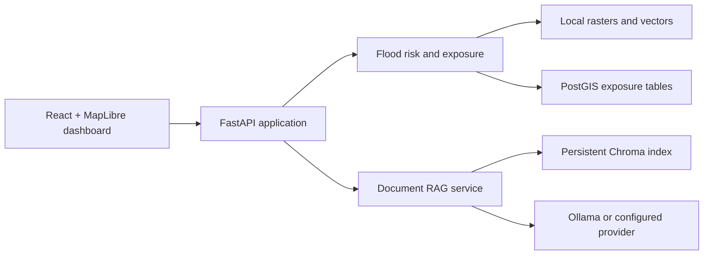

# Disaster Risk Intelligence

Flood risk and exposure workspace for Mumbai Suburban. The React dashboard talks to one FastAPI entrypoint; that API exposes the risk engine and local GIS catalog, and forwards document questions to the separately deployed RAG service.

## Service layout



`backend/rag/` should stay a separate application from `backend/app/`. Both currently use an `app` Python package name, and they have different dependencies, model settings, health checks, and storage. Run them as separate processes/containers in the same repository and connect them over HTTP. The API gateway normalizes the RAG response for the dashboard.

## Local development

Use three terminals from the repository root.

**Risk API and dashboard server** (Python 3.11+):

```powershell
py -m venv .venv
.venv\Scripts\Activate.ps1
python -m pip install -r backend\requirements.txt
$env:BUILDING_EXPOSURE_BACKEND = "disabled"
uvicorn app.main:app --app-dir backend --reload --host 127.0.0.1 --port 8000
```

Use `BUILDING_EXPOSURE_BACKEND=postgis` after the database is reachable and its expected tables have been loaded. The default project settings currently select PostGIS, so local runs without a database should set it to `disabled` or `file`.

**RAG API:** follow [backend/rag/SETUP.md](backend/rag/SETUP.md). It listens on port 8080 by default. Set `RAG_API_URL` in the API process if you use another port.

**React dashboard:**

```powershell
Set-Location frontend
npm ci
npm run dev
```

Open [http://127.0.0.1:5173](http://127.0.0.1:5173). Vite proxies `/api` to the API on port 8000. The dashboard includes the assessment form, satellite/terrain basemaps, source layers, exposure metrics, historical data inventory, RAG copilot, and data exports. Use `frontend/.env.local` to configure alternate satellite or terrain tile URL templates. The default basemaps use Esri services and show their required attribution.

## Compose development stack

From the repository root:

```powershell
Copy-Item .env.example .env
docker compose up --build
```

The Compose stack exposes the dashboard/API at port 8000, RAG at 8080, PostGIS at 5432, and Ollama at 11434. Local datasets are mounted read-only into the API container. The database container is empty on first start: load the configured building, railway, and infrastructure tables before enabling PostGIS exposure. The sample database credentials and Compose ports are for local development; replace them and restrict network access before deployment.

## API routes

| Route | Purpose |
| --- | --- |
| `GET /api/v1/health` | API liveness |
| `GET /api/v1/system/status` | API, guidance, and PostGIS status |
| `GET /api/v1/overview` | Local dataset inventory and map layer availability |
| `GET /api/v1/layers/{layer_id}` | Bounded GeoJSON map features |
| `GET /api/v1/rasters/{raster_id}` | Reprojected raster preview for the map |
| `POST /api/v1/risk/assess` | Flood risk and exposure assessment |
| `POST /api/v1/analyze` | Natural-language spatial query adapter/local fallback |
| `POST /api/v1/guidance` | RAG guidance proxy |
| `GET /docs` | OpenAPI documentation |

Flood assessment currently uses the configured local raster/vector data and PostGIS adapters. The returned risk score is the versioned deterministic flood engine result. Other hazard types are represented in the API schema but return `not_implemented` until their engines exist. Read the response methodology and data limitations before using an assessment operationally.

## Google Earth Engine downloads

Install the optional client and authenticate once:

```powershell
python -m pip install -r scripts\requirements-gee.txt
earthengine authenticate
$env:EARTHENGINE_PROJECT = "your-earth-engine-project-id"
python scripts\gee_download.py --project $env:EARTHENGINE_PROJECT
```

The downloader stores GeoTIFFs and a provenance manifest under `data/gee_downloads/` by default. Pass an authoritative Polygon boundary with `--aoi` for production analysis; the built-in Mumbai vicinity is approximate.

## Production RAG plan

The RAG service currently has a PDF ingestion CLI, multilingual E5 embeddings, persistent local Chroma, metadata filters, retrieval diagnostics, citations, and selectable Ollama/Grok/Gemini/Bedrock answer providers. That is a useful local foundation, not a complete production service. See [docs/production-rag.md](docs/production-rag.md) for the staged deployment design, security, ingestion, retrieval evaluation, reliability, and operations work still needed.

## Terminal 1

cd /d D:\python_projects\disaster-risk-intelligence
D:\python_projects\.venv\Scripts\activate.bat
set BUILDING_EXPOSURE_BACKEND=disabled
python -m uvicorn app.main:app --app-dir backend --reload --host 127.0.0.1 --port 8000

## Terminal 2
cd /d D:\python_projects\disaster-risk-intelligence\backend\rag
.venv\Scripts\activate.bat
python -m uvicorn app.main:app --reload --host 127.0.0.1 --port 8080


## Terminal 3
cd /d D:\python_projects\disaster-risk-intelligence\frontend
npm run dev